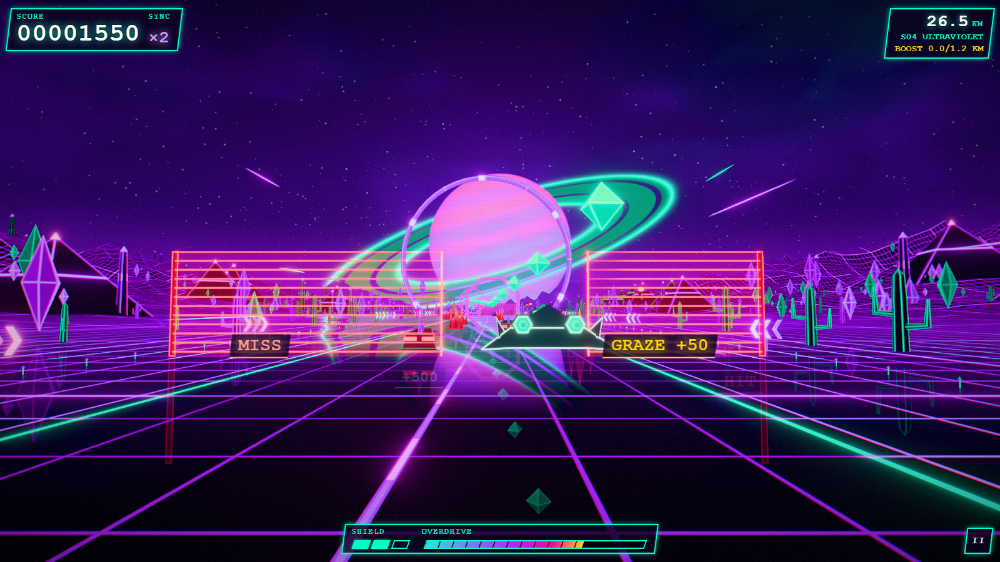
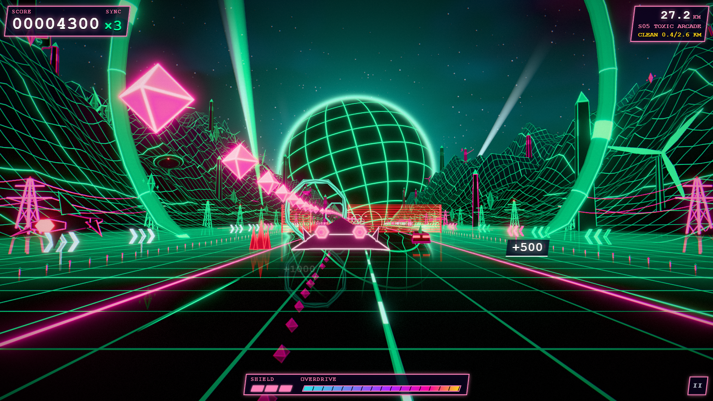
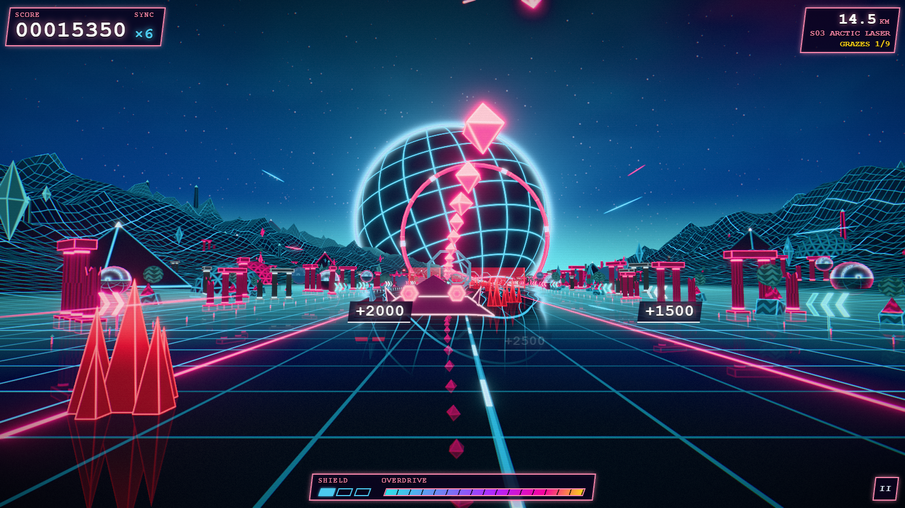

# Midnight Vector

An endless 80s synthwave arcade game that runs in your browser. You fly a low hover-delta down a neon valley toward a banded sun that never moves on screen, while mountains, palms, arcologies, chrome orbs and saucers stream past. The road never stops: there is no game over, and no pause that freezes the world.

**Play it:** https://highsierralabs.github.io/Midnight_Vector/

https://github.com/user-attachments/assets/e20a989e-7f0a-4b51-bb5a-d8ccab93d632

| Crystal Desert | Cyber Canyon | Olympus |
|---|---|---|
|  |  |  |

## How to play

Leave it alone and an autopilot flies under the title screen, so the page works as a screensaver. Press LAUNCH, or any key, to start a run and turn the sound on. LAUNCH - NO HUD starts the same run with the display hidden.

- Collect shards and thread gates on the beat to raise the SYNC multiplier.
- Graze hazards for bonus score, and spend overdrive on boost.
- A hit costs a shield, half your SYNC and some speed. It never ends the run. At zero shields the signal drops for three seconds, the shields refill, and you keep your score.
- Each new sector changes the palette, the biome, the objective and the music key.

| Device | Controls |
|---|---|
| Keyboard | WASD or arrow keys steer, Space boosts, Esc or P opens the cruise menu, M mutes, C changes the camera |
| Mouse | The ship follows the pointer, and the left button boosts |
| Touch | Drag with one finger to steer. A second finger or the on-screen button boosts, and the II button opens the cruise menu |

Hold to boost, or press boost twice quickly to lock it on.

There are three cameras: chase, behind the ship; cockpit, from the pilot's seat, with the readouts on the dashboard; and nose, with nothing of the ship in view. Press C, or the CAMERA button in the cruise menu, to step through them. Your choice is remembered, and the title screen always uses chase.

On a phone the game plays in landscape. Held upright, it asks you to turn the phone, and a run in progress waits in the cruise menu until you do. Tablets play either way up.

The cruise menu has the music and effects volumes, mute, the camera, quality, fullscreen, hide HUD and reduced motion. It is not a pause: the rules freeze and the hazards turn to ghosts, but the world keeps moving behind it.

Your best score and furthest distance are kept in your browser's local storage. Nothing is sent anywhere.

## The prompt

The build started from this prompt:

> Make me a 3D website that's a kind of video game, with an infinite procedural retro 80's futuristic synthwave terrain and a camera that keeps moving forward through it forever. The terrain should be full of stuff and objects, look beautiful with shaders and all, be stylish and scroll on forever.
>
> First, write an architecture.md that outlines the planned app design, the tech stack you will use, the programming language, listing the most important libraries and frameworks. Then write an Agents.md with proven best-practices for the tech you will use.
>
> Add a section about the use of plan files in Agents.md, according to common best practices.
>
> Split the prompt up into different, largely independent tasks. Create plans for each individual task before implementing them.

## Requirements

A browser with JavaScript and WebGL2 with floating-point render targets. Where those are missing, the page shows a still poster and says so. Picture quality adapts to the device, and you can set it yourself in the cruise menu.

## What is in it

- TypeScript, [three.js](https://threejs.org) and [postprocessing](https://github.com/pmndrs/postprocessing), built with [Vite](https://vite.dev). Those two libraries are the only runtime dependencies.
- No asset files. The terrain, sky, props, ship and screen effects are custom GLSL, and the music and sound effects are synthesized with Web Audio.
- The world is generated from a seed. No absolute world coordinate ever reaches a GLSL float, so the picture stays correct however far you travel.

The design is described in [architecture.md](architecture.md).

## Run it locally

You need Node `>=24.14.1 <25`.

```sh
npm ci
npm run dev       # development server
npm run build     # static site in dist/
npm run preview   # serve dist/
npm run check     # typecheck, lint, unit tests and the GLSL gate
```

The browser test suites (`npm run test:smoke` and the other `test:*` scripts) use Playwright with a locally cached Chromium. Their reference images are made per machine and are not in the repository, so a fresh clone has no visual baselines.

## Contributing

See [CONTRIBUTING.md](CONTRIBUTING.md).

## License

[MIT](LICENSE), copyright (c) 2026 Kris E. Granholm. The built game bundles three.js (MIT) and postprocessing (Zlib); see [THIRD-PARTY-NOTICES.md](THIRD-PARTY-NOTICES.md).
